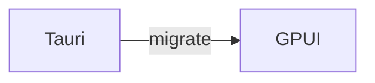

# 欢迎使用 SoloMD (GPUI)

这是迁移后的原生版本。

- 编辑后 ⌘S 保存，标题出现 • 表示未保存
- 左侧点击打开笔记，⌘N 新建
- 图片：截图后 ⌘V 直接粘贴

# 外部追加内容 Wed Aug 26 00:58:05 CST 2026
# 外部追加 1787677206
# 外部追加 1787677332
# 外部追加 1787677518
# ext 1787677728
# ext 1787677796
# ext2 1787677991
# ext3 1787678167
# ext-final 1787678396
